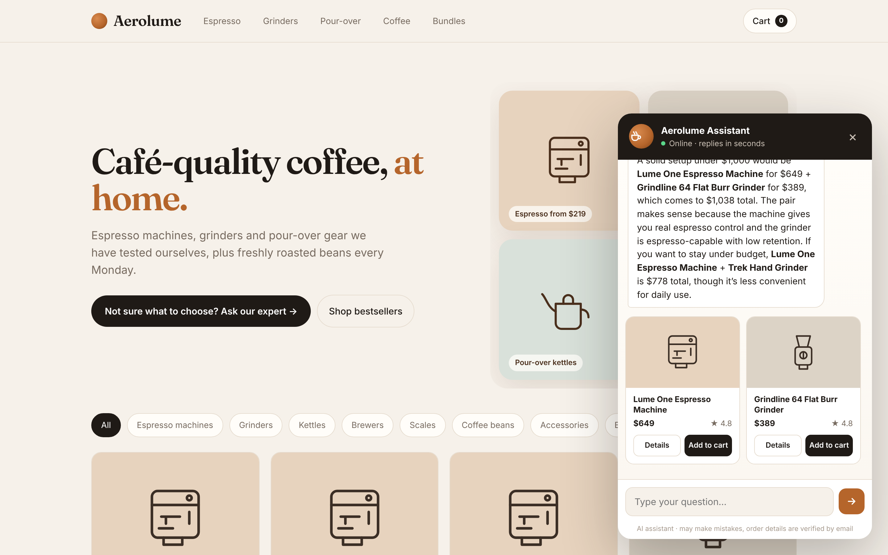
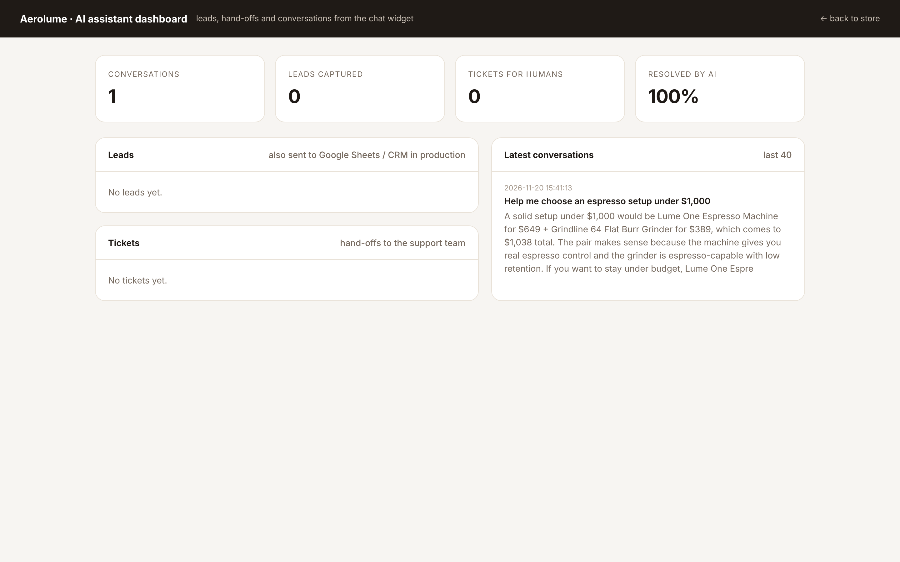

# ShopAssist: AI sales and support agent for an online store


A chat widget that sells and supports like a good shop assistant. It recommends real products from your catalogue, tracks orders, answers policy questions word for word, captures leads, and hands hard cases to your team with a ticket.





## What it does
- **Product advice that converts.** It asks one clarifying question if needed, searches the catalogue, recommends up to 3 products with a reason for each, and shows product cards with **Add to cart**.
- **Order tracking with verification.** Order status is shown only when the order number and email match, with a carrier, tracking number and delivery-timeline card.
- **Policy answers** come from your own policy text (shipping, returns, warranty, subscriptions, payment, price match). Nothing is made up.
- **Lead capture**, with consent, for quotes, restock alerts and expert call-backs.
- **Human hand-off:** complaints and refund disputes become tickets for your support team.
- **Admin dashboard** at `/admin` shows leads, tickets and the latest conversations. In production these go to Google Sheets, HubSpot, Zendesk or Slack.
- **Any language:** customers can write in their own language.

## How it works
A tool-calling agent built on the OpenAI Chat Completions API (Anthropic is also supported). Six tools are defined in `app/main.py`: `search_products`, `get_product`, `check_order`, `get_policy`, `save_lead` and `handoff_to_human`. The model never sees data it does not need, and the order tool enforces the email check itself. Responses stream token by token, and tool results are sent to the widget as rich cards.

## Run it
```bash
pip install -r requirements.txt
export OPENAI_API_KEY=sk-...
uvicorn app.main:app --port 8010       # store: http://localhost:8010, admin: /admin
```
The sample data in `data/` is for a fictional store, Aerolume. To use it with a real shop, replace the tool functions with calls to Shopify, WooCommerce or your own API. The widget is a single script tag.
